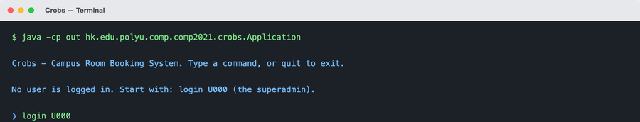
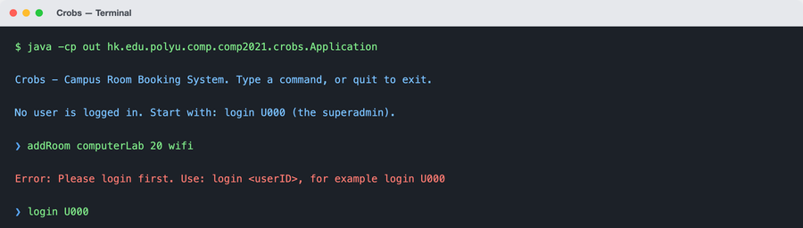
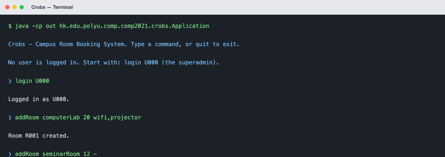
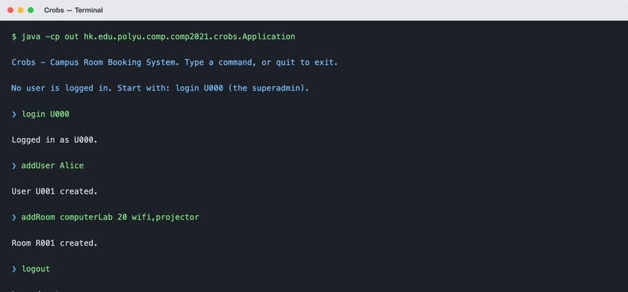
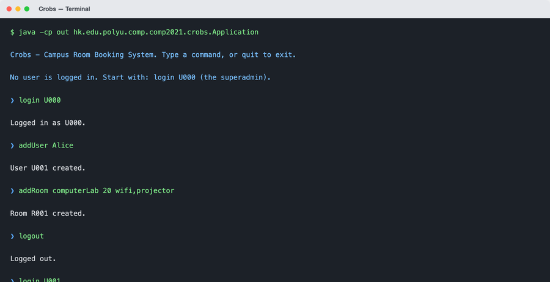
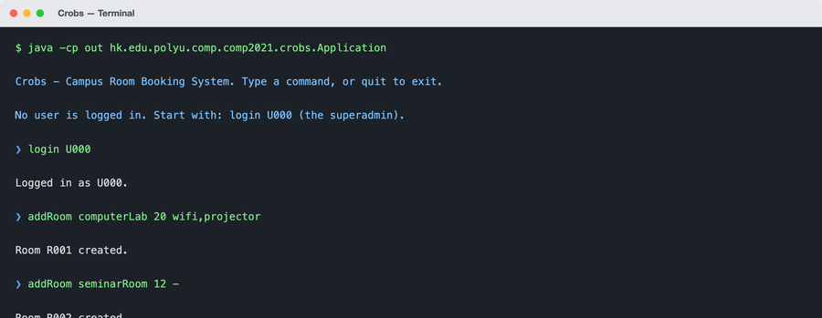
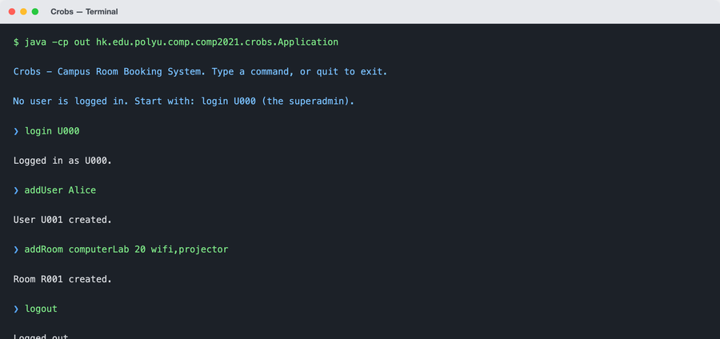
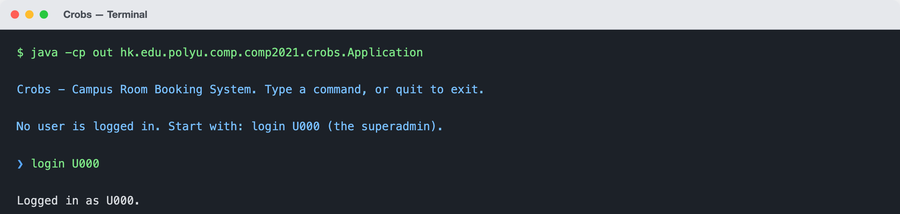
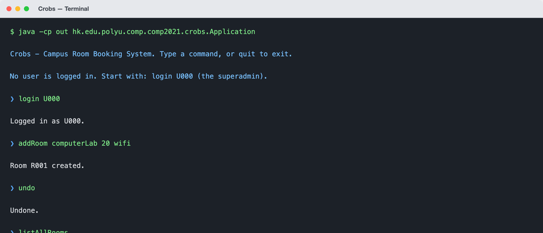

# Crobs — Campus Room Booking System

## User Manual

Version 1.0 · 19 November 2026
COMP2021 Object-Oriented Programming · Group Project

---

## 1. What Crobs does

Crobs is a command-line booking system for the rooms of a campus. It lets a
member of staff or a student

* keep a list of rooms (lecture theatres, computer labs, seminar rooms and
  meeting rooms) with a capacity and a set of features,
* book a room for a purpose on a given day between two times, without ever
  double-booking the same room,
* search for a room that is free in a given window, large enough, and equipped
  with the features the caller needs, and
* look at a week of one room, either as an administrator or as a regular user.

Everything is typed on the console, one command per line. The program also
writes a log of every command it receives, in plain text and in HTML, when
those log files are asked for on the command line.

The system keeps its data in memory only: when the program ends, the users,
rooms and bookings are gone. The log files on disk are the record of what
happened in a session.

---

## 2. Requirements

| Item | Requirement |
| --- | --- |
| Java Development Kit | JDK 25 (the version used by this project) |
| IDE (optional) | IntelliJ IDEA, Project SDK 25, language level 8 |
| Operating system | Any system with a Java 25 runtime; tested on macOS |
| Terminal | Any terminal that can run `java` |

The program has no external library dependency at run time. The JUnit jar in
`lib/` is only needed to run the unit tests.

---

## 3. What is in the delivery

```
crobs/
├── src/                    the application source (42 classes)
│   └── hk/edu/polyu/comp/comp2021/crobs/
│       ├── Application.java        entry point and command loop
│       ├── controller/             parser, dispatcher, one class per command
│       ├── model/                  CROBS facade, User, Room, Booking, ...
│       ├── io/                     TXT and HTML command loggers
│       └── view/                   console output
├── test/                   the JUnit test suite (177 tests)
├── lib/                    junit-platform-console-standalone-1.14.0.jar
├── docs/                   this manual, architecture, design and status notes
├── crobs.iml               IntelliJ module file
└── README.md               short project overview
```

---

## 4. Starting the program

Compile once, from the project root:

```bash
javac -encoding UTF-8 -d out $(find src -name "*.java")
```

Then run it:

```bash
java -cp out hk.edu.polyu.comp.comp2021.crobs.Application
```

Two optional options control the command logs:

```bash
java -cp out hk.edu.polyu.comp.comp2021.crobs.Application -txt log.txt -html log.html
```

| Option | Effect |
| --- | --- |
| `-txt <file>` | write every command to a plain-text file |
| `-html <file>` | write every command to an HTML table |

Either option may be given alone, both may be given in any order, and both are
optional. **A file path that cannot be opened is reported as one line, and the
program stops before asking for any command**, rather than running without the
log that was requested.

When the program starts it prints two lines: the banner, and a reminder of the
first thing a new session needs.

```
Crobs - Campus Room Booking System. Type a command, or quit to exit.
No user is logged in. Start with: login U000 (the superadmin).
```



The program ends when `quit` is typed, or when the input ends (for example when
input is piped from a file). The exit status is `0` for a normal run and `1`
when the command line is wrong or a log file cannot be written.

---

## 5. The first thing to know: you must log in

The system creates **one user when it starts: the superadmin, with the fixed ID
`U000`**. Nobody is logged in at the beginning, and every command that touches
data is refused until somebody is:

```
login U000
Logged in as U000.
```

Only the superadmin can create users. The first user created gets `U001`, the
next `U002`, and so on. Rooms and bookings are numbered the same way: `R001`,
`R002`, … and `B001`, `B002`, …

### Roles

| Role | Created how | What it may do |
| --- | --- | --- |
| Superadmin | automatically, `U000` | everything, including creating users, changing roles and removing users |
| Admin | `changeRole U00x admin` | add, modify and delete rooms; see every booking in a schedule |
| Regular | `changeRole U00x regular` | book, modify and delete **own** bookings; search; see a schedule with other users hidden |

The three roles are the only ones the system knows. `changeRole` accepts the
words `admin` and `regular`; the role of the superadmin can never be changed.

### Who may run what

| Command | Superadmin | Admin | Regular | Logged out |
| --- | --- | --- | --- | --- |
| `login` / `logout` / `quit` | ✔ | ✔ | ✔ | `login` only |
| `addUser` `removeUser` `changeRole` | ✔ | – | – | – |
| `addRoom` `modifyRoom` `deleteRoom` | ✔ | ✔ | – | – |
| `book` `modifyBooking` `deleteBooking` `listBookings` | ✔ | ✔ | ✔ (own only) | – |
| `search` `schedule` `listRoom` `listAllRooms` | ✔ | ✔ | ✔ | – |
| `undo` `redo` | ✔ | ✔ | ✔ | – |

A command that is refused because of the role prints one of:

```
Error: Please login first. Use: login <userID>, for example login U000
Error: Only an admin can do that. Log in as the superadmin (login U000) to manage users and rooms
Error: Only the superadmin can do that.
```

Each refusal names the missing step, so a newcomer does not have to guess that
the superadmin must log in first:



---

## 6. How to write a command

* One command per line. Command words are **case-insensitive**: `addRoom`,
  `addroom` and `ADDROOM` are the same command.
* Arguments are separated by spaces.
* **An argument that contains a space must be wrapped in double quotes**, for
  example a booking purpose: `book R001 2026-11-20 09:00 10:00 "Group meeting"`.
  An unclosed quote is an error.
* A name and a purpose may be given without quotes when they are a single word.
* Two formats are used and nothing else:

| Value | Format | Examples | Rejected |
| --- | --- | --- | --- |
| Date | `yyyy-MM-dd` | `2026-11-20` | `20/11/2026`, `2026-2-30`, `2026-02-29` (not a leap year) |
| Time | `HH:mm`, 24-hour clock | `09:00`, `23:59` | `9:00`, `24:00`, `09:60` |

* `undo` and `redo` take no argument at all: `undo`, not `undo 3`.

* A room's features are written as a **comma-separated list**, for example
  `wifi,projector`. The list is compared case-insensitively and duplicates are
  ignored, so `Wifi,WiFi,projector` is the same set as `wifi,projector`.
  A single hyphen `-` means **no features**.

---

## 7. Command reference

### 7.1 `login userID`

Log in as a user. Prints `Logged in as <userID>.`

```
login U000
Logged in as U000.
```

Errors: `User U999 does not exist.` · `User U001 is already logged in.`

Logging in again while somebody is logged in switches the current user without
requiring a logout first.

### 7.2 `logout`

Log out. Prints `Logged out.`

### 7.3 `quit`

End the program. Nothing is printed. All data is lost; the only record is the
log file, if one was requested.

### 7.4 `addUser name` — superadmin only

Create a user and print the generated ID. The name may contain spaces without
quotes when it is written as the last argument.

```
addUser Alice
User U001 created.

addUser Chan Tai Man
User U002 created.
```

Errors: `The name must not be empty.`

### 7.5 `removeUser targetUserID` — superadmin only

Delete a regular user **and every booking that user owns**.

```
removeUser U001
Done.
```

Errors: `Only a regular user can be removed.` (the superadmin and admins cannot
be removed) · `User U001 does not exist.`

### 7.6 `changeRole targetUserId newRole` — superadmin only

Promote a user to `admin` or demote an admin to `regular`.

```
changeRole U002 admin
Done.
```

Errors: `Unsupported role "boss".` · `The role of the superadmin cannot be changed.`

### 7.7 `addRoom roomType capacity features` — superadmin or admin

Create a room and print its ID. The four room types are `lectureTheatre`,
`computerLab`, `seminarRoom` and `meetingRoom`, written exactly like that
(case-insensitive).

```
addRoom computerLab 20 wifi,projector
Room R001 created.

addRoom seminarRoom 12 -
Room R002 created.
```

Errors: `Unsupported room type "lab".` · `Capacity must be a positive integer.`




### 7.8 `modifyRoom roomID field newValue` — superadmin or admin

Change one field of a room. The field is one of `type`, `capacity`, `features`.

```
modifyRoom R001 capacity 30
Done.

modifyRoom R001 features "wifi,projector,whiteboard"
Done.
```

Errors: `Unknown room field "name".` · `Room R001 does not exist.`

Existing bookings of the room are kept when the room is modified. Lowering the
capacity below the number of people already booked is allowed, because a
booking does not record a headcount.

### 7.9 `deleteRoom roomID` — superadmin or admin

Delete a room. **Bookings of that room that are still in the future are
cancelled; bookings that already happened are kept as history.**

```
deleteRoom R001
Done.
```

Errors: `Room R001 does not exist.`

### 7.10 `book roomId date startTime endTime purpose`

Create a booking for the **logged-in user**.

```
book R001 2026-11-20 09:00 10:00 "Group meeting"
Booking B001 created.
```

Rules: the start time must be earlier than the end time; the purpose must not
be empty; the room must exist; and the new interval must not overlap an
existing booking of the same room.

```
book R001 2026-11-20 09:30 10:30 "Clash"
Error: Room R001 is already booked from 09:00 to 10:00 on 2026-11-20.

book R001 2026-11-20 10:00 11:00 "Adjacent"
Booking B002 created.
```

Note the second case: two bookings that only touch at `10:00` do **not**
overlap, so they are both accepted. A booking that is completely contained in
another one is rejected.

Errors: `Start time must be earlier than end time.` · `The purpose must not be
empty.` · `Invalid date "2026-11-31", expected yyyy-MM-dd.` · `Invalid time
"9:00", expected HH:mm.` · `Room R001 does not exist.`






### 7.11 `modifyBooking bookingID roomId date startTime endTime purpose`

Replace every detail of an existing booking. All six arguments are always
required, even when only one detail changes.

```
modifyBooking B001 R001 2026-11-20 16:00 17:00 "Moved"
Done.

modifyBooking B001 R002 2026-11-21 09:00 10:00 "Moved"
Done.
```

Only the owner of a booking may modify it. A booking never conflicts with
itself, so moving a booking to a time it already overlaps is accepted. Every
other rule of `book` applies.

Errors: `You can only change your own bookings.` · `Booking B009 does not
exist.` · `Room R001 is already booked from … on …`

### 7.12 `deleteBooking bookingID`

Delete one of the caller's own bookings.

```
deleteBooking B001
Done.
```

Errors: `You can only change your own bookings.` · `Booking B009 does not exist.`

### 7.13 `search date startTime endTime minCapacity features` — anyone logged in

List every room that is **free for the whole window**, has at least
`minCapacity` seats, and has **all** the features asked for. When the feature
argument is `-`, any room of sufficient capacity and availability matches.

```
search 2026-11-20 09:00 11:00 15 wifi,projector
R001 computerLab 20 wifi,projector

search 2026-11-20 09:00 11:00 10 wifi
No matching room.
```

The second example returns nothing because `R001` is booked from `09:00` to
`10:00`: a room already booked inside the window is not available, even if it
is free for part of it.

Errors: `Minimum capacity must be a non-negative integer.` · the usual date and
time errors.




### 7.14 `schedule roomId weekStartDate` — anyone logged in

Show the bookings of one room for the **seven days starting on
`weekStartDate`**. The starting day is included and the eighth day is not.

```
schedule R001 2026-11-20

B001 2026-11-20 09:00-10:00 U001 Group meeting
B002 2026-11-20 10:00-11:00 U001 Adjacent
```

**Who sees what.** A regular user sees `***` in place of the user ID of a
booking that belongs to somebody else, so the timetable is readable without
exposing who booked what:

```
schedule R001 2026-11-20
B001 2026-11-20 14:00-15:00 *** Bob sync
```

An admin or the superadmin sees the real user IDs. When the room has no booking
in that week the answer is `No booking in this week.`

Errors: `Room R001 does not exist.`




### 7.15 `listRoom roomID` — anyone logged in

Show one room as one line: id, type, capacity, features.

```
listRoom R001
R001 computerLab 20 wifi,projector
```

A room without features shows a hyphen in that column.

### 7.16 `listAllRooms` — anyone logged in

Show every room, **sorted by room ID in ascending order**.

```
listAllRooms
R001 computerLab 20 wifi,projector
R002 seminarRoom 12 -
```




### 7.17 `listBookings` — anyone logged in

Show every booking owned by the logged-in user, **sorted by date and then by
start time**. The user ID column is omitted because every line is the caller's
own.

```
listBookings
B001 2026-11-20 09:00-10:00 Group meeting
B002 2026-11-20 10:00-11:00 Adjacent
```

When the caller has no booking the answer is `No booking.`

### 7.18 `undo` — anyone logged in

Undo the most recent command that **changed** the state. Which commands those
are:

| Can be undone | Cannot be undone (they change nothing) |
| --- | --- |
| `addUser` `removeUser` `changeRole` `addRoom` `modifyRoom` `deleteRoom` `book` `modifyBooking` `deleteBooking` | `login` `logout` `search` `schedule` `listRoom` `listAllRooms` `listBookings` `quit` |

```
login U000
Logged in as U000.
addRoom computerLab 20 wifi
Room R001 created.
undo
Undone.
listAllRooms
redo
Redone.
listAllRooms
R001 computerLab 20 wifi
```

(The `listAllRooms` between `undo` and `redo` prints nothing, because the room
is gone at that moment.)

Undo restores the **whole** state as it was before that command, including the
side effects: undoing `deleteRoom` brings the room back with the bookings it
had, undoing `removeUser` brings the user back with their bookings, and undoing
`addRoom` also gives the room ID back, so the next `addRoom` creates `R001`
again. At most one command can be undone per `undo`; type it again to go further
back. Reading commands such as `listAllRooms` do not disturb the undo history.

Answers: `Undone.` or `Nothing to undo.`




### 7.19 `redo` — anyone logged in

Re-apply the command that was undone last. **A new state-changing command
clears the redo history**, because the future that was undone no longer exists.

Answers: `Redone.` or `Nothing to redo.`

---

## 8. Complete worked example

The session below creates two users and two rooms, books a room, tries a
clashing time, searches, and shows a week of the room.

```
Crobs - Campus Room Booking System. Type a command, or quit to exit.
login U000
Logged in as U000.
addUser Alice
User U001 created.
addUser Bob
User U002 created.
addRoom computerLab 20 wifi,projector
Room R001 created.
addRoom seminarRoom 12 -
Room R002 created.
listAllRooms
R001 computerLab 20 wifi,projector
R002 seminarRoom 12 -
login U001
Logged in as U001.
book R001 2026-11-20 09:00 10:00 "Group meeting"
Booking B001 created.
book R001 2026-11-20 09:30 10:30 "Clash"
Error: Room R001 is already booked from 09:00 to 10:00 on 2026-11-20.
book R001 2026-11-20 10:00 11:00 "Adjacent"
Booking B002 created.
listBookings
B001 2026-11-20 09:00-10:00 Group meeting
B002 2026-11-20 10:00-11:00 Adjacent
search 2026-11-20 10:00 12:00 10 wifi
No matching room.
schedule R001 2026-11-20
B001 2026-11-20 09:00-10:00 U001 Group meeting
B002 2026-11-20 10:00-11:00 U001 Adjacent
logout
Logged out.
quit
```

---

## 9. The command log

Run with `-txt` and/or `-html` to keep a record of the commands of a session.

* **Text log** — one line per command, numbered from 1:
  ```
  1 login U000
  2 addUser Alice
  ```
* **HTML log** — one table with a header row and one row per command, so it can
  be opened in any browser.

Only the commands are logged; the program's answers are printed on the console
but are not written to the log file. A command that was refused because of a
wrong argument count or an unknown word is still a command that was typed, and
is logged like any other line.

---

## 10. Error messages and what to do

Every error is printed on one line that starts with `Error: `. Nothing is
changed when a command fails.

| Message | Cause | What to do |
| --- | --- | --- |
| `Please login first. Use: login <userID>, for example login U000` | a data command was typed with nobody logged in | `login U000` (or another ID) first |
| `Unknown command "boook".` | the command word is not in the list | check the spelling in section 7 |
| `Wrong number of arguments for "book".` | too few or too many words | compare with the syntax line of the command |
| `Invalid date "20/11/2026", expected yyyy-MM-dd.` | wrong date format or an impossible date | write `2026-11-20`; `2026-02-30` is rejected too |
| `Invalid time "9:00", expected HH:mm.` | wrong time format | write `09:00` |
| `Start time must be earlier than end time.` | the end time is not after the start | swap the two times |
| `Room R001 is already booked from 09:00 to 10:00 on 2026-11-20.` | the interval overlaps an existing booking | pick another time, or look at `schedule` first |
| `Room R001 does not exist. An admin can add one with: addRoom` | the room ID is unknown or the room was deleted | `listAllRooms` shows the rooms that exist |
| `User U009 does not exist.` | the user ID is unknown or the user was removed | `login` with an existing ID |
| `Booking B009 does not exist.` | the booking ID is unknown | `listBookings` shows the caller's bookings |
| `You can only change your own bookings.` | the booking belongs to somebody else | modify only your own bookings |
| `Only an admin can do that. Log in as the superadmin (login U000) to manage users and rooms` / `Only the superadmin can do that.` | the role is too low for the command | ask an admin, or `login U000` |
| `No room yet. An admin can add one with: addRoom roomType capacity features` | `listAllRooms` was run before any room existed | not an error: create a room with `addRoom` |
| `Only a regular user can be removed.` | `removeUser` was given an admin or `U000` | demote first with `changeRole`, then remove |
| `The role of the superadmin cannot be changed.` | `changeRole U000 …` | the fixed superadmin stays as it is |
| `Capacity must be a positive integer.` | zero, negative or a word was given | give a whole number greater than zero |
| `Unsupported room type "lab".` | the type word is not one of the four | see section 7.7 |
| `Unknown room field "name".` | `modifyRoom` was given a field that does not exist | use `type`, `capacity` or `features` |
| `The name must not be empty.` / `The purpose must not be empty.` | a blank argument | type a real value |
| `Nothing to undo.` / `Nothing to redo.` | there is nothing on that stack | run a state-changing command first, then `undo` |
| `Please type a command.` | an empty line was entered | it is harmless; type a command |
| `Error: unterminated quoted argument.` | a `"` was opened and never closed | close the quote |

---

## 11. Questions that come up

**I typed `addUser` and got "Please login first".**
The system starts with nobody logged in. The only user that exists at the start
is `U000`, the superadmin, and only the superadmin may create users.

**Where do the IDs come from?**
Users, rooms and bookings are numbered in creation order, `U001`/`R001`/`B001`
onwards. The IDs are never reused in a session: after deleting `U002`, the next
user is still `U003`.

**Is the data saved when I quit?**
No. Only the command log on disk survives. Start a new session with an empty
system.

**Can two people book the same room at the same time?**
No. Overlapping intervals are refused for the same room on the same day. Two
intervals that only touch (`09:00–10:00` and `10:00–11:00`) are not overlapping
and are both accepted. Different rooms never conflict with each other.

**Why does `schedule` show `***` instead of a name?**
A regular user sees the timetable of the room but not who booked it. Log in as
an admin (or `U000`) to see user IDs.

**Can I cancel my booking after it started?**
Yes. `deleteBooking` works on any of the caller's own bookings, past or future.
A room that is deleted keeps the bookings that already happened and cancels
only the future ones.

**How many days does `schedule` show?**
Seven, starting on the date given. `schedule R001 2026-11-20` covers 20 to 26
November, not 19 and not 27.

**Nothing appears when I type a command.**
An empty line prints `Please type a command.` and does nothing else. If the
terminal shows no reaction at all, the program has ended (after `quit` or after
the end of piped input); start it again.
